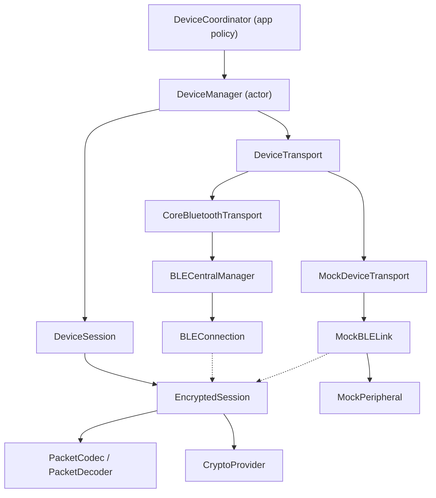
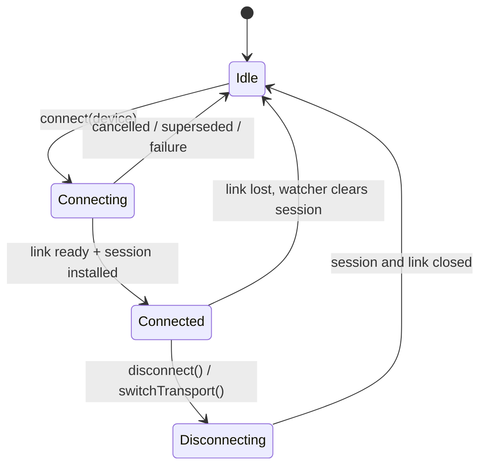
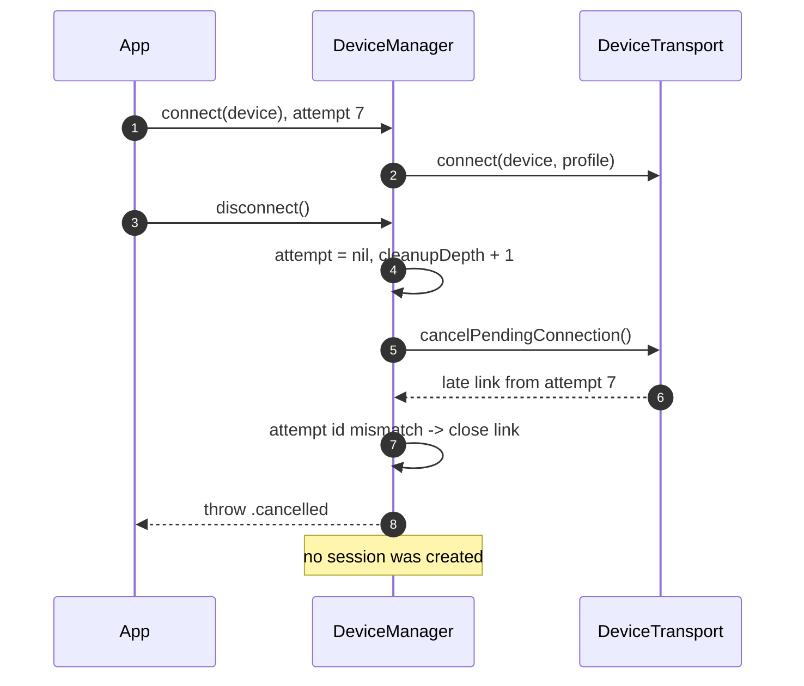
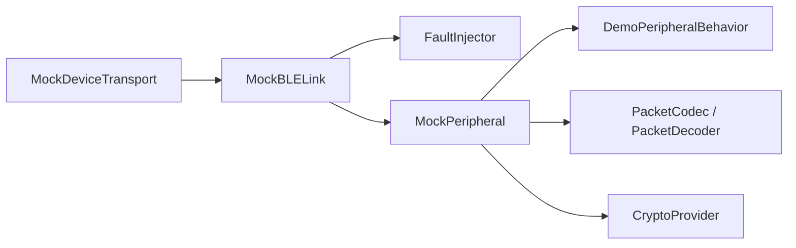

# ModuBLE Architecture

This document explains **why ModuBLE is built the way it is**, and how the modules cooperate to produce a testable, verifiable encrypted BLE link. It is a design document, not an API reference and not a directory listing.

**Intended readers:** Swift/iOS engineers evaluating the design, BLE and IoT teams reviewing module boundaries, and technical reviewers interested in asynchronous communication and test strategy.

After reading it you should be able to answer:

1. What is the overall architecture?
2. What happens to a request from the app to the peripheral and back?
3. How are connection lifecycle, concurrency and failures handled?
4. How can the link be verified without dedicated BLE hardware?

Related documents:

| Document | Responsibility |
|---|---|
| [`README.md`](README.md) | Project overview, quick start, capability summary |
| [`Documentation/Peripheral-GATT.md`](Documentation/Peripheral-GATT.md) | Exact GATT UUIDs, frame layout, commands, peripheral contract |
| [`Documentation/Device-Verification.md`](Documentation/Device-Verification.md) | Real-device checklist, recorded results, failure triage |
| [`Documentation/Demo-Script.md`](Documentation/Demo-Script.md) | Recording script for the portfolio demo |

---

## 1. Overview

### Project scope

ModuBLE is a Swift package plus two demo apps:

- an iOS app that discovers, connects, encrypts requests and renders telemetry;
- a macOS app that acts as the reference BLE peripheral.

The SDK spans the path from CoreBluetooth to an encrypted request/response and event session. The demo payload (telemetry and the `START`/`STOP` command set) is intentionally small so the transport and session design stays visible.

### Design goals

1. **Testability without hardware.**
   Framing, reassembly and cryptography are pure Swift. The session layer talks to a byte link, not to CoreBluetooth, so the whole protocol can run against a deterministic mock.

2. **One-way dependencies.**
   CoreBluetooth is confined to the BLE layer. Device, session, protocol and crypto code can be compiled and tested without a radio.

3. **Deterministic asynchronous behaviour.**
   One connection and one in-flight request at a time; explicit lifecycle phases; timeouts that are armed in a defined order; no implicit request queue.

4. **Honest verification.**
   The document distinguishes *implemented*, *unit-tested* and *hardware-verified*. A passing mock test does not imply that a real BLE telemetry link has been validated.

### Non-goals

- Production-grade security (replay protection, mutual authentication, key provisioning).
- Multiple simultaneous connections or multiplexed requests.
- Application-layer reliability (ACK windows, selective retransmit).
- Modelling radio behaviour such as RSSI variation, connection parameters or ATT congestion.
- Interoperability certification with commercial BLE hardware.

---

## 2. System Architecture

### Architecture diagram



Dotted edges are protocol conformance, not construction: both `BLEConnection` and `MockBLELink` conform to `DeviceLink`, which is the only thing the session layer sees.

### Module responsibilities

| Layer | Types | Responsibility | CoreBluetooth dependency |
|---|---|---|---|
| `BLE` | `BLECentralManager`, `BLEConnection`, `MTUChunker` | Scan, connect, GATT discovery, TX subscription, MTU-aware chunked writes, link state | Yes — only here |
| `Transport` | `DeviceTransport`, `CoreBluetoothTransport`, `MockDeviceTransport`, `MockBLELink`, `MockPeripheral`, `FaultInjector` | Transport-agnostic discovery/connect and the deterministic virtual device | No (mock), adapter only (CoreBluetooth) |
| `Device` | `DeviceSession`, `DeviceManager` | One device conversation, connection attempt lifecycle, single-session policy | No |
| `Session` | `EncryptedSession`, `SessionEvent` | Encrypt, frame, correlate responses, time out, dispatch events | No |
| `Protocol` | `Packet`, `PacketCodec`, `PacketDecoder` | Frame layout and streaming reassembly | No |
| `Crypto` | `CryptoProvider`, `AESGCMProvider`, `AESCBCProvider` | Sealed envelopes and key derivation | No |
| `Logging` | `CommunicationLogStore` | Ordered, bounded structured log | No |
| `Demo` | `Telemetry`, `TelemetryCodec`, `DemoPeripheralBehavior`, `DemoTestKey` | Demo business payload and shared command semantics | No |

### Dependency direction

```text
App
 └── Device (DeviceManager → DeviceSession)
       ├── Session (EncryptedSession)
       │     ├── Protocol
       │     └── Crypto
       └── Transport
             ├── BLE (CoreBluetooth)
             └── Mock (virtual peripheral)
```

- The session layer depends on `BLELink` and `CryptoProvider`, never on CoreBluetooth.
- Device code depends on `DeviceTransport` and `DeviceLink`, not on concrete transports.
- The mock and the real link are interchangeable at the `DeviceLink` boundary.
- Protocol and crypto have no dependency on BLE at all, which is what makes exhaustive unit testing possible.

`DeviceManager` is the convenient entry point when an app wants one owned session and a connection lifecycle. Tests and diagnostics can bypass it and use a `DeviceTransport` plus `DeviceSession` directly; the session layer does not require the manager.

### Core abstractions

| Abstraction | Contract | Why it exists |
|---|---|---|
| `BLELink` | `inbound` byte stream, `write`, `close` | Smallest surface the session needs; easy to fake |
| `DeviceLink` | `BLELink` + device identity, connection state, MTU limits | The session also needs to know *which* device and *how much* fits per write |
| `DeviceTransport` | `scan`, `connect`, `cancelPendingConnection`, Bluetooth state | Unifies real and virtual devices behind one API |
| `CryptoProvider` | `encrypt`, `decrypt`, `algorithm`, `maxPlaintextLength` | Lets the session switch algorithms without knowing the envelope details |
| `ConnectionState` | `disconnected`, `connecting`, `discovering`, `ready`, `failed(reason)` | Link-level state exposed to the device layer and UI |
| `DeviceManager.ConnectionPhase` | `idle`, `connecting`, `connected`, `disconnecting` | Manager-level lifecycle that also covers the in-flight attempt |
| `SessionEvent` / `DeviceEvent` | Decrypted event payload, sequence, timestamp, optional telemetry | Separates protocol events from demo business decoding |

### Concurrency model at a glance

| Component | Mechanism | Reason |
|---|---|---|
| `BLECentralManager` / `BLEConnection` | Private serial `DispatchQueue` + `@unchecked Sendable` | CoreBluetooth callbacks already arrive on a queue; keeping state queue-confined avoids locks |
| `DeviceManager` | Swift `actor` | Shared mutable state (transport, session, attempt) |
| `EncryptedSession` | `NSLock` | Continuations and pending slots are accessed from the receive loop, timeout tasks and callers |
| `CommunicationLogStore` | `NSLock` | Appends from many threads, read by the UI |

---

## 3. Connection Lifecycle

### Manager phases

`ConnectionPhase` is the manager's view. It intentionally has a `connecting` state even though `currentSession` is still `nil`, because a second `connect()` must be able to see that an attempt is already running.



The link itself has a separate `ConnectionState`:

| State | Meaning |
|---|---|
| `disconnected` | No usable link |
| `connecting` | `CBPeripheral.connect` in progress |
| `discovering` | Service/characteristic discovery or TX subscription in progress |
| `ready` | Writes and notifications are usable |
| `failed(reason)` | The link ended unexpectedly; `reason` is diagnostic text |

### Scanning and discovery

1. `DeviceManager.scan()` forwards to the selected `DeviceTransport`.
2. `CoreBluetoothTransport` delegates to `BLECentralManager.scan(profile:)`.
3. `BLECentralManager` keeps a service-filtered `CBCentralManager` scan on its serial queue and yields the full, sorted device list on every discovery.
4. Terminating the stream or calling `stopScan()` stops the scan.

The mock transport ignores the radio and yields a fixed catalogue, but it uses the same `DiscoveredDevice` shape.

### Connection and GATT setup

1. `BLECentralManager.connect` ensures Bluetooth is powered on.
2. On its queue it rejects a second connection, resolves the `CBPeripheral` (or recovers it from the system cache after an app restart), and creates a `BLEConnection`.
3. It calls `central.connect` and waits. A 15-second timer prevents a silent peripheral from leaving the caller suspended.
4. Once connected, `BLEConnection.prepare()` moves the link through `discovering`:
   - discover the service;
   - discover the RX/TX characteristics;
   - subscribe to TX notifications.
5. A 10-second preparation timer covers service discovery and subscription.
6. On success the link emits `ready`; on failure it emits `failed` and cancels the ATT connection.

`BLEConnection` negotiates both write limits and exposes `maximumWritePayloadLength` (with response) and `maximumWritePayloadLengthWithoutResponse` (the latter implies `ATT MTU = value + 3`).

### Session establishment

`DeviceManager.connect` coordinates the hand-off from transport to session:

1. Refuse if a session exists or an attempt is already in flight.
2. Allocate a monotonic **attempt id** and capture the current transport.
3. `await transport.connect(...)`.
4. Re-validate after the actor hop: same attempt id, not cancelled, no session installed meanwhile.
5. Close the link immediately if any of those checks fail.
6. Create the `CryptoProvider` through the injected factory and wrap the link in `DeviceSession`.
7. Install the session, start a watcher, and return it.

If the crypto factory throws, the link is closed before the error is rethrown; a half-open connection is never left behind.

### Disconnect and cleanup

`DeviceManager.disconnect()`:

- invalidates any in-flight attempt;
- clears the current session and its watcher;
- closes the session, which closes `EncryptedSession` (pending caller, receive loop, event stream) and then the link;
- asks the attempt's transport to cancel its pending connection, if any.

`DeviceSession.close()` is idempotent. It finishes the event streams, closes the encrypted session, cancels observer tasks, and closes the link. The manager's watcher also releases a session that closes because the link was lost.

### Transport switching

`switchTransport` does not call `disconnect` and then blindly swap. It first invalidates the attempt, closes the current session, cancels the attempt on the **old** transport, and only then publishes the new transport. New connects are refused while this cleanup is suspended, so a cancellation cannot land on a fresh attempt.

### Reconnect policy

Reconnect is deliberately **not** part of the SDK. `DeviceCoordinator` owns backoff, "pause while Bluetooth is off", attempt counters and UI state. The SDK only guarantees that a connect attempt can be cancelled or superseded safely.

---

## 4. Communication Pipeline

### The one-request rule

`EncryptedSession` allows exactly one in-flight request. Concurrent callers receive `SessionError.busy`; there is no queue.

This is a deliberate trade-off:

- BLE writes are serialized anyway;
- one pending continuation makes response matching and timeout ownership unambiguous;
- the demo never needs request pipelining.

The cost is throughput: a caller that wants to send the next command must wait for the previous response or timeout.

### Request flow

1. `DeviceSession.request(payload)` checks that the session is open and forwards to `EncryptedSession`.
2. The session snapshots the current `CryptoProvider`, rejects payloads above `maxPlaintextLength`, and encrypts.
3. It reserves a request id and a `UInt32` sequence under the session lock.
4. It encodes the frame:
   `Magic "MB" | Version | Kind | Sequence | Payload Length | Payload`.
5. It installs the pending slot, **then** arms the timeout, then starts the write.
6. The write is MTU-chunked by `BLEConnection` (or by `MockBLELink` on the mock path).

```mermaid
sequenceDiagram
    autonumber
    participant App
    participant Session as DeviceSession
    participant Enc as EncryptedSession
    participant Crypto as CryptoProvider
    participant Link as BLELink
    participant Dev as Peripheral

    App->>Session: request(payload)
    Session->>Enc: request(payload)
    Enc->>Crypto: encrypt(plaintext)
    Crypto-->>Enc: sealed envelope
    Enc->>Enc: reserve id + sequence, encode frame
    Enc->>Enc: install pending, arm timeout
    Enc->>Link: write(frame)
    Link->>Dev: MTU chunk 1..n
    Dev-->>Link: notification(frame)
    Link-->>Enc: inbound bytes
    Enc->>Enc: PacketDecoder -> response
    Enc->>Crypto: decrypt(payload)
    Crypto-->>Enc: plaintext
    Enc->>Enc: finish(onlyIf: requestID)
    Enc-->>Session: plaintext
    Session-->>App: response
```

### Response flow

Inbound bytes are not frame-aligned: a notification may contain part of a frame, several frames, or legacy plain-text status. `PacketDecoder` buffers and resynchronises on the `MB` magic.

For a `response`:

1. Take a snapshot of the pending request.
2. Drop the frame if there is no pending request.
3. Drop it if the sequence does not match; a late response must not complete or fail the current request.
4. Decrypt with the provider snapshot.
5. Commit atomically with `finish(result, onlyIf: requestID)`.

The commit point is what makes timeout and close meaningful:

- the pending slot stays installed **during decryption**;
- if the timeout fires first, the caller gets `.timedOut` and the later decrypt result is discarded;
- if `close()` wins, the caller gets `.closed`;
- if a new request is already pending, the old id no longer matches and the result is dropped;
- the response path also cancels the timeout only when it actually commits.

Once a request has been resolved locally, the write path is not started: an unattachable timer or a pending slot that disappeared before the write task runs stops the write. This matters for control commands such as `START` and `STOP`.

### Events versus responses

| Kind | Matching | Delivery |
|---|---|---|
| `response` | By `sequence`, one pending request | Resumes the request continuation |
| `event` | No request correlation | Decrypted and yielded on `EncryptedSession.events` |
| `raw` | None | Logged; not interpreted |
| `request` from peripheral | None | Logged as unexpected |

`DeviceSession` consumes `EncryptedSession.events`, decodes the demo telemetry payload when possible, and republishes `DeviceEvent`s. A malformed event is dropped; it does not tear down the session.

`inbound` is single-consumer and owned by `EncryptedSession`; `events` is single-consumer and owned by `DeviceSession`. A second reader would steal buffered data.

### Framing and MTU

- Fixed header: 2-byte magic, version, kind, 4-byte sequence, 2-byte payload length (10 bytes total).
- Maximum payload: 4096 bytes, enforced before allocation.
- No CRC by design: BLE protects the link, and the sealed envelope carries an AEAD tag or HMAC.
- `MTUChunker` splits writes at the negotiated payload limit; the decoder reassembles on the other side.
- `PacketDecoder` resets after an unrecoverable framing error and resumes at the next magic sequence.

### Telemetry decoding

The demo telemetry payload is 14 bytes: version, kind, yaw/pitch/roll in signed centidegrees, battery, flags, uptime. `DeviceEvent` always keeps the raw payload; when `TelemetryCodec` cannot decode it, `telemetry` is `nil` and the event is still delivered.

---

## 5. Concurrency and State Management

This is the part of the SDK where most of the engineering effort sits. Swift's `async`/`await` does not make shared state safe by itself: an actor can interleave at every `await`, and a continuation can be resumed from several tasks.

### DeviceManager: actor reentrancy

`DeviceManager` is an actor, but `transport.connect` suspends. A second `connect`, a `disconnect`, a transport switch or a cancellation can all run before the link returns.

The protections are:

| Mechanism | Problem it solves |
|---|---|
| `ConnectionPhase` / `isConnecting` | A second `connect` must see an attempt even though `currentSession` is still `nil` |
| Monotonic attempt id | A late link cannot be mistaken for the current attempt |
| Post-await re-validation | `disconnect` / `switchTransport` / `cancel` that ran during the await must win |
| Close-on-invalid | A stale link is closed; no `DeviceSession` is created |
| `cleanupDepth` | New connects are refused while teardown is suspended, so cancellation cannot hit a fresh attempt |
| `Task.isCancelled` check | Cancelling a reconnect task prevents a session from being installed |
| Pre-write pending check | A request that already resolved must not start a BLE write |



Two known limits are documented rather than hidden:

- CoreBluetooth's `cancelPendingConnection` covers the ATT connect, not every phase of GATT setup. `DeviceManager` compensates by closing a link that arrives after invalidation.
- An ATT write that has already started cannot be unsent. The SDK guarantees "do not start a write after local resolution", not "the device never executed it".

### EncryptedSession: pending reservation

A request must not lose its continuation if two callers race:

1. A caller reserves a `(requestID, sequence)` under the lock.
2. Only one reservation can exist; the next caller gets `.busy`.
3. The reservation is promoted to a `Pending` slot atomically.
4. If the session closed in between, the promotion fails and the caller is resumed with `.closed`.

`requestID` is a monotonic `UInt64`; `sequence` is the wire-level `UInt32` and may wrap. The id, not the sequence, decides which request a result belongs to.

### Timeout ordering

The timer must never fire before the pending slot exists. Otherwise `finish` finds nothing, the timer is lost, and a silent peripheral can leave the caller suspended forever.

The order is therefore:

1. install `pending` (with no timer);
2. create and attach the timeout task;
3. if the request already finished, cancel the new timer;
4. start the write.

Timeouts, closes, responses and write failures all compete through the same `finish` gate. Whoever removes the pending slot first wins; everyone else observes no slot and returns.

### Close semantics

`EncryptedSession.close()`:

- marks the session closed and clears any reservation;
- resolves the current pending request with `.closed`;
- finishes the event stream;
- cancels the receive task and closes the link.

If a response is being decrypted when `close()` runs, the caller is released immediately; the decryption result is committed only if the same request is still pending, which it is not.

### Event stream lifecycle

`EncryptedSession.start()` starts one receive loop. It owns the only `PacketDecoder` instance and consumes `inbound` sequentially, so packet ordering is preserved.

The loop ends when `inbound` ends. Closing the session cancels the receive task and closes the link, which finishes `inbound`; on termination the loop marks the session closed, resolves any pending request, and finishes `events`.

### Invariants and their tests

| Invariant | Regression coverage |
|---|---|
| Two concurrent requests cannot both win the pending slot | `testConcurrentRequestsNeverLeakAContinuation` |
| A timed-out request can be replaced without a stale slot | `testTimeoutReleasesTheSlot` |
| A late response cannot complete or fail the next request | `testLateResponseFromTimedOutRequestDoesNotCompleteNextRequest`, `testCorruptLateResponseDoesNotFailNextRequest` |
| A response that finishes decrypting after timeout is discarded | `testDecryptionFinishingAfterTimeoutDoesNotCompleteNextRequest` |
| `close()` releases a request stuck in decryption | `testCloseDuringResponseDecryptionReleasesRequest` |
| A timeout cannot be lost before pending installation | `testImmediateTimeoutIsNotLostBeforePendingInstallation` |
| Concurrent connects and late links are rejected | `DeviceManagerConcurrencyTests` |

---

## 6. Mock and Fault Injection

### Mock architecture



The mock replaces **only the radio**. `MockPeripheral` uses the real frame codec, decoder and crypto providers, so a mock round trip exercises the same framing, MTU chunking, authentication and decryption as a real link.

### Shared protocol components

| Component | Real path | Mock path |
|---|---|---|
| Framing | `PacketCodec` | `PacketCodec` |
| Reassembly | `PacketDecoder` | `PacketDecoder` |
| Crypto | `AESGCMProvider` / `AESCBCProvider` | Same providers |
| Commands | `DemoPeripheralBehavior` | Same behaviour |
| MTU chunking | `MTUChunker` in `BLEConnection` | `MTUChunker` in `MockBLELink` |
| Transport contract | `BLEConnection: DeviceLink` | `MockBLELink: DeviceLink` |

### Fault configuration

`FaultInjector` is seedable and counters are exposed to the demo. The knobs map directly to BLE failure modes:

| Fault | Effect |
|---|---|
| `latency` | Delays request writes and therefore their responses; telemetry emission is not delayed |
| `dropRate` | The frame never arrives; the caller hits its timeout |
| `corruptRate` | A payload byte is flipped; AEAD/HMAC authentication fails |
| `malformedRate` | The length field is damaged; the decoder cannot find the frame |
| `disconnectAfterRequests` | Drops the link after N requests |
| `disconnectAfterEvents` | Drops the link after N events |

There is deliberately no "CRC error" knob: the protocol has no CRC, so corruption must fail authentication and header damage must fail framing.

### Test boundaries

The mock validates software behaviour, not radio performance. It does **not** model RSSI variation, connection parameters, ATT congestion, notification queue overflow or real timing jitter. Those remain properties of the physical link.

The plain-text fallback (`RX #n: k bytes` for non-protocol writes) exists for compatibility with the earlier demo; it is not part of the encrypted request/response contract.

---

## 7. Security Design

### CryptoProvider abstraction

`EncryptedSession` never names a concrete cipher. It asks a `CryptoProvider` to seal and open payloads and to report the maximum plaintext that fits. The sealed envelope is self-describing: its first byte selects the format, so the peer can follow a mid-connection switch.

### Envelopes

| Algorithm | Version | Layout |
|---|---|---|
| AES-128-GCM | `0x01` | `Version (1) | Nonce (12) | Ciphertext (n) | AuthTag (16)` |
| AES-128-CBC + HMAC-SHA256 | `0x02` | `Version (1) | IV (16) | Ciphertext (n) | HMAC (32)` |

### AES-GCM

- 128-bit key, 96-bit random nonce per message.
- GCM authenticates the whole message; modifying the nonce, ciphertext or tag makes decryption fail instead of returning attacker-chosen plaintext.
- The random nonce is acceptable for demo-scale traffic. A deployment that encrypts millions of messages under one key should use a counter-based nonce.

### AES-CBC + HMAC

- One 256-bit master key is expanded with HKDF-SHA256 into a 16-byte AES key and a 32-byte HMAC key.
- The construction is Encrypt-then-MAC: the HMAC covers `Version | IV | Ciphertext`.
- The MAC is verified **before** decryption, so a modified IV, ciphertext or version never reaches the CBC primitive.
- CBC provides no integrity on its own; the MAC is the integrity layer.

### Payload limits

The 4096-byte frame limit applies to the sealed envelope, not the plaintext:

- GCM usable plaintext: **4067 B**;
- CBC usable plaintext: **4031 B**.

`EncryptedSession` rejects larger payloads before encoding with `SessionError.payloadTooLarge(max:)`.

### Algorithm switching

Because the version byte is inside the authenticated envelope, the receiver can select the provider from the first byte. The demo switches algorithms mid-connection and re-issues `START` so subsequent events use the new format.

Switching while a request is in flight is **not serialized**. The response may still be sealed with the old algorithm and fail authentication. The safe contract is to let the in-flight request finish before switching; the demo's algorithm control and the command chain do not currently enforce that boundary.

### Security limitations

This is a portfolio-grade SDK, not a production security product:

- no replay protection (`sequence` only correlates requests and responses);
- no mutual authentication or key agreement;
- no key rotation or provisioning;
- the demo key is public and must never be used outside the demo;
- no application-layer CRC (BLE and the AEAD/HMAC provide integrity).

See `README.md` → **Limitations** for the full list.

---

## 8. Testing and Verification

### Test layers

| Layer | What is tested | Examples |
|---|---|---|
| Protocol | Frame round trips, streaming reassembly, resynchronisation, size limits | `PacketCodecTests`, `MTUChunkerTests`, `BLELinkTests` |
| Crypto | NIST CBC vectors, GCM/CBC round trips, tampering, wrong key, cross-format rejection | `AESGCMProviderTests`, `AESCBCProviderTests` |
| Session | Timeouts, stale responses, concurrent requests, close, algorithm switch, payload limits | `EncryptedSessionTests`, `EncryptedSessionConcurrencyTests`, `EncryptedSessionEventTests`, `EncryptedSessionLimitsTests` |
| Device layer | Lifecycle, link-loss release, transport switching, attempt races, crypto failure cleanup | `DeviceSessionTests`, `DeviceManagerTests`, `DeviceManagerConcurrencyTests` |
| Mock | Scan/connect, chunked round trips, telemetry, faults | `MockTransportTests`, `FaultInjectorTests` |
| Demo payload | Telemetry wire format, command semantics | `TelemetryTests`, `DemoPeripheralBehaviorTests` |

Current suite: **168 tests** (`swift test`).

### Concurrency regression tests

These are not generic async tests; each one reproduces a real failure mode:

- **Reservation race:** 128 simultaneous callers over 20 rounds; exactly one wins each round, everybody else gets `.busy`, nobody leaks a continuation.
- **Late response:** a response for a timed-out request must not complete or fail the next request.
- **Decrypt across timeout:** a response that is still decrypting when the timeout fires must be discarded.
- **Close during decrypt:** `close()` must release the caller immediately, even while a slow provider is inside `decrypt`.
- **Timeout before installation:** the timer is armed only after the pending slot exists; an immediate scheduler cannot lose the timeout.
- **Connection attempt races:** concurrent connects, disconnect during connect, transport switch during connect, cancelled tasks and late links all close the link instead of creating a session.

### Verification levels

The following distinction is intentional:

| Level | Meaning |
|---|---|
| Implemented | Code exists in the package |
| Unit-tested | Covered by automated tests, usually against the mock |
| Hardware-verified | Exercised between a physical iPhone and the macOS peripheral |

| Capability | Implemented | Unit-tested | Hardware-verified |
|---|---|---|---|
| Framing / reassembly / MTU chunking | ✅ | ✅ | ✅ |
| AES-128-GCM request/response | ✅ | ✅ | ✅ |
| AES-128-CBC + HMAC and mid-connection switch | ✅ | ✅ | ✅ |
| Encrypted large-payload echo | ✅ | ✅ | ✅ |
| Telemetry events | ✅ | ✅ (mock) | ⬜ pending |
| Reconnect after link loss | ✅ | ⚠️ link-loss release only; backoff is app policy | ⬜ pending |
| Connection lifecycle races | ✅ | ✅ | — |

Recorded real-link results (2026-11-14) and the remaining checklist items are in [`Documentation/Device-Verification.md`](Documentation/Device-Verification.md).

### Running the tests

```bash
swift build
swift test
```

The iOS demo and macOS peripheral are built without signing in CI with `CODE_SIGNING_ALLOWED=NO`.

---

## 9. Known Trade-offs and Future Work

| Decision | Why | Cost |
|---|---|---|
| One connection per manager | A BLE central rarely needs more in this demo; a single session keeps lifecycle and UI state simple | No concurrent device conversations |
| One in-flight request | Unambiguous matching, timeout ownership and cancellation | No pipelining; callers must chain commands |
| Timeout is local | The app must never wait forever on a silent peripheral | A timeout does not prove the device did not execute an already-started write; no retry/query layer |
| Explicit attempt ids and cleanup gate | Actor reentrancy is unavoidable across `await` | More state than a naive `guard session == nil` |
| Single-consumer event streams | `AsyncStream` shares one buffer between iterators | A second reader would steal events; `DeviceSession` is the intended owner |
| Mock latency applies to writes only | Keeps telemetry emission deterministic for tests | Event latency is not simulated |
| No replay protection | Keeps the demo protocol small | A captured frame can be replayed |
| Pre-shared demo key | Zero provisioning for the demo | No identity, no rotation, not production-safe |

### Future work

- Replay protection with a monotonic receive window.
- ECDH + HKDF session key agreement.
- Multiple concurrent connections.
- An optional request queue, while keeping the one-in-flight wire constraint.
- Application-layer reliability (window, ACK bitmap, selective retransmit).
- Background restoration and state preservation.
- Serialize algorithm switches behind the in-flight command queue.
- Real-link telemetry and reconnect verification with a physical iPhone.

The guiding principle stays the same: **separate transport, framing, cryptography and session management so that each layer can be tested and evolved independently** — and state the verification level of each capability instead of implying more than was tested.
