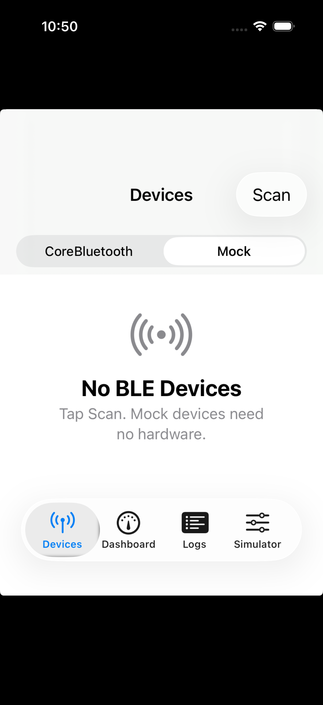

# ModuBLE

ModuBLE is a modular Swift BLE communication SDK designed to demonstrate a testable device communication stack, from CoreBluetooth transport to encrypted sessions and telemetry streaming. It includes a deterministic mock peripheral and a macOS BLE peripheral for software-level and real-link verification.

> 中文文档：[README.zh-CN.md](README.zh-CN.md)

---

## Project Overview

ModuBLE keeps CoreBluetooth behind a byte-oriented link, layers authenticated request/response and event streams on top, and ships an iOS demo that can run against either a virtual peripheral or a macOS CoreBluetooth peripheral.

The package is structured so each layer can be tested without a radio: protocol and crypto are pure Swift, the session layer depends only on `BLELink` and `CryptoProvider`, and the mock transport exercises the same code path as a real device.

## Key Features

- **A testable BLE core.** Packet framing, reassembly, AES-GCM and AES-CBC+HMAC are pure Swift with no CoreBluetooth dependency, so the whole protocol is unit-tested.
- **A device layer, not just a scanner.** `DeviceTransport` → `DeviceSession` → `DeviceManager` gives one API for discovery, connection lifecycle, encrypted requests and decoded telemetry.
- **Two verification paths.** A deterministic mock runs the full software stack with no hardware; the macOS peripheral app exercises a real BLE link.
- **Honest fault injection.** Latency, dropped frames, corrupted AEAD payloads, malformed headers and mid-stream disconnects — all seedable and reproducible.

## Demo

Both transports feed the same SwiftUI app; switching the transport only changes the link underneath.

| Tab | Contents |
|---|---|
| **Devices** | Transport picker, scan, RSSI, Mock / CoreBluetooth source, connect |
| **Dashboard** | Yaw / pitch / roll, battery, uptime, event count, sample rate |
| **Logs** | Structured TX/RX log with copy and clear |
| **Simulator** | Fault controls and live injection counters |
| **Diagnostics** | Raw writes, chunk test, paced transfer, MTU details |



A shot-by-shot recording plan is in [Documentation/Demo-Script.md](Documentation/Demo-Script.md).

## Quick Start

### Prerequisites

- Swift 6 / Xcode 16 or newer
- SDK: iOS 16+ or macOS 13+
- iOS demo: iOS 17+ (uses `ContentUnavailableView` and two-parameter `onChange`)

### Build and test

```bash
git clone https://github.com/Suncoldx333/ModuBLE.git
cd ModuBLE

swift build
swift test
```

### iOS demo without hardware

1. Open `Demo/ModuBLEDemo.xcodeproj`, choose an iPhone simulator, run.
2. Keep the **Mock** transport selected, tap **Scan**, connect to `Mock Motion Sensor`.
3. The app sends `START` automatically; the Dashboard starts updating at 1 Hz.
4. Open **Simulator** to inject latency, drops, corrupted payloads or a disconnect.

### Real BLE link

1. Run `Demo/BLEPeripheralApp.xcodeproj` on a Mac and press **Start Advertising**.
2. On the iPhone, switch the transport to **CoreBluetooth** and scan for `MacBLE`.
3. Connect, then send `START` from the Dashboard or Quick Commands.

### Use as a dependency

There are no release tags yet:

```swift
.package(url: "https://github.com/Suncoldx333/ModuBLE.git", branch: "main")
```

## Architecture

```text
iOS app (SwiftUI)
  └── DeviceCoordinator          app policy: tab state, reconnect backoff
        └── DeviceManager        actor: transport choice, one session
              └── DeviceSession  requests, events, lifecycle
                    ├── EncryptedSession   seal / frame / match / decrypt
                    └── DeviceLink         device identity + state + MTU
                          ├── CoreBluetoothTransport → BLECentralManager
                          └── MockDeviceTransport    → MockBLELink
                                                        └── MockPeripheral
```

Dependencies point one way: the session layer knows `BLELink` and `CryptoProvider`, never CoreBluetooth. That is what makes the mock path a real test of the software rather than a UI stub.

| Layer | Responsibility | Depends on CoreBluetooth |
|---|---|---|
| `BLE` | Scan, connect, GATT discovery, notifications, MTU-aware writes | Yes (only here) |
| `Transport` | Transport-agnostic discovery/connect; mock implementation | No |
| `Device` | Session lifecycle, decoded events, single-connection policy | No |
| `Session` | Encrypt, frame, correlate responses, time out, dispatch events | No |
| `Protocol` | Frame codec and streaming reassembly | No |
| `Crypto` | AES-128-GCM and AES-128-CBC + HMAC-SHA256 | No |
| `Logging` | Ordered, bounded in-memory log | No |

### Repository layout

```text
ModuBLE/
├── Package.swift                   Swift package root (usable as a dependency)
├── Sources/ModuBLE/
│   ├── BLE/                        CoreBluetooth central + connection
│   ├── Transport/                  DeviceTransport, CoreBluetooth + Mock transports
│   ├── Device/                     DeviceSession, DeviceManager
│   ├── Protocol/                   Frame codec, streaming decoder
│   ├── Crypto/                     CryptoProvider, AES-GCM, AES-CBC + HMAC
│   ├── Session/                    EncryptedSession, event stream
│   ├── Logging/                    Structured, ordered log store
│   └── Demo/                       Telemetry codec, command table, demo keys
├── Tests/ModuBLETests/             168 XCTest cases
├── Documentation/
│   ├── Peripheral-GATT.md          GATT contract and wire protocol
│   ├── Device-Verification.md      Real-device checklist and results
│   └── Screenshots/
├── Demo/
│   ├── ModuBLEDemo.xcodeproj       iOS demo
│   └── BLEPeripheralApp.xcodeproj  macOS reference peripheral
└── .github/workflows/ci.yml        Tests + unsigned builds of both apps
```

### API at a glance

| Type | Purpose |
|---|---|
| `BLECentralManager` | Bluetooth state, scanning, connection, cancellation |
| `BLEConnection` | GATT discovery, TX subscription, MTU chunked writes, state stream |
| `BLELink` | Minimal byte link used by the session layer |
| `DeviceLink` | `BLELink` + device identity, connection state, MTU |
| `DeviceTransport` | Transport-agnostic scan/connect; CoreBluetooth and mock implementations |
| `EncryptedSession` | Encrypted request/response, timeout, algorithm switch, event stream |
| `SessionEvent` / `DeviceEvent` | Decrypted events; `DeviceEvent` carries parsed telemetry |
| `DeviceSession` | One device conversation with automatic close on link loss |
| `DeviceManager` | Actor facade: transport choice, one session, crypto injection |
| `Telemetry` / `TelemetryCodec` | Demo business payload and its binary format |
| `MockDeviceTransport` / `MockBLELink` / `MockPeripheral` | Deterministic virtual device |
| `FaultInjector` | Latency, drops, corruption, malformed frames, disconnects |
| `CommunicationLogStore` | Ordered, bounded structured log |

## Protocol & Security

### Frame

```text
Magic "MB" (2) | Version (1) | Kind (1) | Sequence (4) | Payload Length (2) | Payload
```

Kinds: `0x01` request, `0x02` response, `0x03` event, `0x7F` raw. Integers are big-endian; the payload limit is 4096 bytes. There is **no CRC**: BLE already protects the link, and the encrypted payload carries an AEAD tag or HMAC.

### Sealed envelope

The first byte identifies the format, so the algorithm can change mid-connection:

```text
AES-128-GCM   0x01 | Nonce (12) | Ciphertext (n) | AuthTag (16)
AES-128-CBC   0x02 | IV (16)    | Ciphertext (n) | HMAC-SHA256 (32)
```

CBC verifies the MAC *before* decrypting. The 32-byte master key is split into AES and HMAC keys with HKDF-SHA256.

Because the 4096-byte limit applies to the envelope, the usable plaintext per request is **4067 B** with GCM and **4031 B** with CBC; `EncryptedSession` rejects larger payloads with `SessionError.payloadTooLarge(max:)`.

### Security properties

- GCM provides authenticated encryption; CBC verifies its HMAC before revealing plaintext.
- The envelope version is authenticated by the AEAD tag / HMAC, so downgrade to another format fails authentication.
- There is **no replay protection, mutual authentication, key agreement or key rotation**. The demo key is public. See [Limitations](#limitations) before using this outside a demo.

### Reference commands

| Request | Reply | Side effect |
|---|---|---|
| `START` | `START_ACK` | start telemetry |
| `STOP` | `STOP_ACK` | stop telemetry |
| `SET_RATE:<hz>` | `RATE:<hz>` | change the 0.2–10 Hz rate |
| `PING` | `PONG` | — |
| anything else | echoed verbatim | — |

The command table lives in `DemoPeripheralBehavior` and is shared by the mock and the macOS app, so the two cannot drift apart.

### Telemetry payload

14 bytes, big-endian, sealed inside an `event` frame:

```text
Version (1) | Kind (1) | Yaw (2) | Pitch (2) | Roll (2)
  | Battery (1) | Flags (1) | Uptime ms (4)
```

Angles are signed centidegrees (`12.34° → 1234`); flag bit 0 is charging. Centidegrees keep the value exact across platforms, avoid NaN, and stay readable in a hex log.

## Testing & Verification

### Automated tests

```bash
swift test        # 168 tests
```

| Area | Coverage |
|---|---|
| Protocol | Frame round trips, byte-by-byte reassembly, magic resync, truncation, oversize frames |
| Crypto | NIST CBC vectors, GCM/CBC round trips, tampering, wrong key, cross-format rejection |
| Session | Timeouts, sequence mismatch, concurrent requests, close semantics, algorithm switch |
| Concurrency | 128-way bursts over 20 rounds: no leaked continuations, no lost requests |
| Events | Decryption, dispatch, malformed-event isolation, stream termination |
| Telemetry | Wire format, sign and range boundaries, forward-compatible decoding |
| Mock | Scan/connect, chunked round trips, telemetry, drop/corrupt/disconnect faults |
| Device layer | Session lifecycle, link-loss release, transport switching, crypto failure cleanup |

The concurrency tests exist because the original session could orphan a continuation when two callers reserved a sequence at the same time; the regression test fails on the old implementation and passes now.

### Deterministic mock and fault injection

The mock uses the real `PacketDecoder`, `PacketCodec` and `CryptoProvider`. It only replaces the radio, so a mock round trip exercises framing, MTU chunking, encryption and decryption exactly like a real link.

```swift
let transport = MockDeviceTransport(logStore: store)
let link = try await transport.connect(device, profile: .referencePeripheral)
let session = DeviceSession(
    link: link,
    crypto: try AESGCMProvider(key: DemoTestKey.aes128GCM)
)

for await event in session.events {
    if let telemetry = event.telemetry { /* dashboard */ }
}

transport.applyFaultConfiguration(
    FaultConfiguration(dropRate: 0.3, latency: .milliseconds(120))
)
```

Faults are seeded (`SplitMix64`), so the same failure sequence can be replayed from a bug report. The mock does **not** model RSSI variation, connection parameters or ATT congestion; it validates software behaviour, not radio performance.

### Verified environment

Checked on 2026-11-19:

| Item | Value |
|---|---|
| Swift | 6.4 |
| Xcode | 27.0 |
| macOS | 27.0 |
| `swift test` | 168 passed, 0 failed |
| macOS peripheral build | Succeeds (`CODE_SIGNING_ALLOWED=NO`) |
| iOS demo build | Succeeds for iOS Simulator |

### Verification status

| Item | Status |
|---|---|
| Unit tests | ✅ 168 passing |
| Both apps build | ✅ Verified |
| Real BLE scan / connect / subscribe | ✅ 2026-11-14, iPhone ↔ macOS |
| With / without response writes | ✅ 2026-11-14 |
| MTU chunking (1000 B → 512 + 488) | ✅ 2026-11-14 |
| AES-128-GCM `START` → `START_ACK` | ✅ 2026-11-14 |
| AES-128-CBC switch mid-connection | ✅ 2026-11-14 |
| Encrypted 1000 B echo | ✅ 2026-11-14 |
| Reconnect after link loss | ⬜ Code complete, hardware run pending |
| Telemetry events over real BLE | ⬜ Mock only so far |

Interoperability with commercial BLE hardware has **not** been validated.

Wire format details and the peripheral contract are in
[Documentation/Peripheral-GATT.md](Documentation/Peripheral-GATT.md); the manual
real-device checklist and recorded results are in
[Documentation/Device-Verification.md](Documentation/Device-Verification.md).

## Limitations

This is a portfolio-grade SDK and demo, not a production security product.

1. **No replay protection.** `sequence` only correlates responses.
2. **No mutual authentication or key agreement.** Both sides share a pre-shared key; the demo key is public.
3. **No key rotation.** Production deployment needs provisioning and rotation.
4. **One connection, one in-flight request.** `EncryptedSession` rejects concurrent requests with `.busy`.
5. **No application-layer reliability.** No ACK bitmap, sliding window or selective retransmit, and no CRC by design.
6. **Plaintext fallback remains.** Non-protocol writes get `RX #n: k bytes` for compatibility with the earlier demo.
7. **`inbound` and `events` are single-consumer streams.** `DeviceSession` is the intended reader.
8. **The macOS peripheral assumes one central.** Concurrent writes from multiple centrals can interleave.
9. **The mock does not model radio behaviour.** Faults are deterministic injections.
10. **Telemetry on the macOS path is not yet validated with a physical iPhone.** The mock path and the SDK are unit-tested; the macOS emitter builds and is wired to the same command table, but the real-link telemetry round trip should be re-run before claiming it.

## Roadmap

- Replay protection (monotonic sequence + receive window)
- ECDH + HKDF session key agreement
- Multiple concurrent connections
- Application-layer reliable transport (window, ACK bitmap, selective retransmit)
- Background restoration and state preservation

## License

MIT — see [LICENSE](LICENSE).
